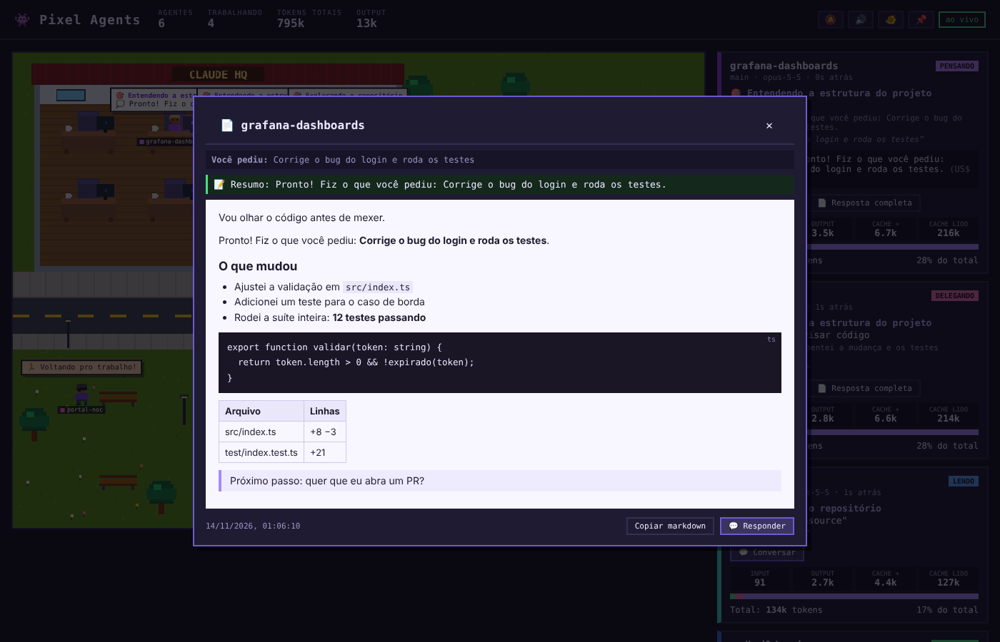
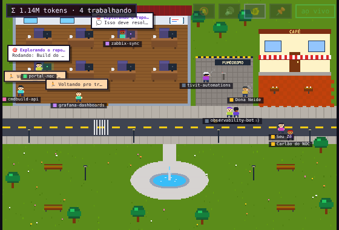

# 👾 Pixel Agents

Uma cidadezinha em pixel art onde **cada terminal do Claude Code vira um morador**. Quando está trabalhando, ele fica na mesa do escritório (Claude HQ) e mostra num balão o que está fazendo (lendo um arquivo, rodando um comando, delegando para um subagente, esperando você…). Quando termina ou o terminal é fechado, ele sai para a cidade: conversa com os outros, toma café, senta no banco da praça ou dá uma pausa no fumódromo. O painel lateral mostra **quantos tokens cada um está gastando**.

## Destaques

- **Balões que explicam o trabalho**: mostram a tarefa em andamento (🎯, vinda da lista de tarefas do Claude), o que ele está fazendo agora e o que ele acabou de dizer (💬).
- **Avisos**: um "plim" e um aviso na tela (e, se você ligar 🔔, uma notificação do sistema) quando um agente **termina** ou **precisa de você**. O título da janela mostra quantos estão esperando.
- **Conversar pela app**: clique num personagem (ou em 💬 Conversar no card) e mande um prompt. A app continua aquela sessão do Claude Code, mostra um **resumo curto** quando ele termina e abre a **resposta completa formatada** num modal.
- **App instalável e modo aquário**: instale como app e deixe a cidade num cantinho da tela, ou fixe por cima das outras janelas (📌).

## A cidade

- **Claude HQ**: o escritório. Cada agente tem a sua mesa.
- **Fumódromo**, **Café** e **praça** com fonte e bancos: para onde os agentes vão quando não estão trabalhando.
- **NPCs** (Dona Neide, Seu Zé, Bia e Carlão do NOC) moram na cidade e conversam, fumam e tomam café junto com os agentes. Desligue com `?npcs=0` na URL.
- **Personagens não somem** quando você fecha o Claude: ficam "de folga" pela cidade por até 7 dias (`--hours`).
- **Dia e noite** seguem o relógio do seu computador. Force com `?day` ou `?night`.
- Quando o Claude volta a trabalhar, o personagem larga o que está fazendo e corre para a mesa.


## Como funciona

O Claude Code grava cada sessão em `~/.claude/projects/<projeto>/<sessão>.jsonl`. O servidor lê esses arquivos de forma incremental (como um `tail -f`), monta o estado de cada sessão e envia para o navegador via Server-Sent Events. Não usa nenhuma dependência externa, só Node.

| Estado        | Quando                                                        | No escritório                    |
|---------------|---------------------------------------------------------------|----------------------------------|
| `digitando`   | Edit, Write, Bash, TodoWrite, MCP…                           | digita no teclado                |
| `lendo`       | Read, Grep, Glob, WebFetch, WebSearch                         | olhando para a tela              |
| `delegando`   | Task/Agent (subagentes)                                       | robozinhos rosas ao lado da mesa |
| `pensando`    | recebeu um prompt ou o resultado de uma tool                  | balão "Pensando..."              |
| `aguardando`  | pergunta para você, ou tool rápida parada há mais de 10s (provavelmente pedindo permissão) | balão amarelo pulando |
| `livre`       | terminou a resposta e está esperando você                     | sai para a cidade                |
| `de folga`    | sem atividade há 30 min (Claude fechado)                      | passeia, conversa, cochila no banco |

### Tokens

Para cada sessão são somados, a partir do campo `usage` das respostas do modelo:

- **input**: tokens de entrada não cacheados
- **output**: tokens gerados
- **cache +**: tokens escritos no prompt cache
- **cache lido**: tokens lidos do cache

Mensagens repetidas no log (o Claude Code grava uma linha por bloco de conteúdo) são deduplicadas pelo `message.id`. Tokens de subagentes são somados ao terminal que os criou e aparecem separados no card.

## Uso

Requer Node 18+.

```bash
git clone https://github.com/GiovanneBordotti/pixel-agents.git
cd pixel-agents
npm start          # lê ~/.claude/projects
# ou
npm run demo       # agentes falsos, para ver funcionando
```

Abra <http://localhost:4567>, ou use `npm run app`, que já abre o navegador.

### Botões

| Botão | O que faz |
|-------|-----------|
| ⬇️ Instalar app | Instala como app (Chrome/Edge). Também dá pelo ícone de instalar na barra de endereço. |
| 🔔 / 🔕 | Notificações do sistema quando um agente termina ou precisa de você |
| 🔊 / 🔇 | Som dos avisos |
| 🐠 | Modo aquário: só a cidade, sem painel, para deixar numa janela pequena |
| 📌 | Fixa a cidade numa janelinha **sempre por cima** das outras (Chrome/Edge 116+) |

### Conversar com um agente

1. Clique no personagem na cidade ou no botão **💬 Conversar** do card.
2. Escreva o prompt e escolha as permissões:
   - **Pode editar arquivos** (padrão): edita arquivos, mas comandos no terminal são negados.
   - **Só ler e responder** ou **Só planejar**: não mexe em nada.
   - **Liberado geral**: edita e roda comandos sem perguntar. Use com cuidado.
3. Enquanto ele trabalha, o personagem vai para a mesa e o card mostra ⏳. Quando termina, chega um aviso com o resumo. Clique no aviso ou em **📄 Resposta completa** para ler tudo formatado.

Por baixo, a app roda `claude -p --resume <sessão> --output-format stream-json` na pasta do projeto, mandando o seu texto pela entrada padrão. O resumo é feito pelo **Haiku** (gasta poucos tokens, numa sessão separada que não aparece na cidade). Para desligar, use `--no-summary`, e o resumo passa a ser só as primeiras frases da resposta.

> Não mande prompt pela app para uma sessão que está aberta num terminal ao mesmo tempo: os dois podem se atropelar.
> O envio só funciona com o servidor em `localhost` e só aceita pedidos da própria página (outros sites não conseguem mandar comandos). Para desligar de vez: `--no-prompts`.

Se o comando `claude` não estiver no PATH, aponte com `CLAUDE_BIN=/caminho/do/claude`.



### Como app (o "aquário")

1. Rode `npm start` e abra <http://localhost:4567> no Chrome ou no Edge.
2. Clique em **⬇️ Instalar app** (ou no ícone de instalar na barra de endereço).
3. O Pixel Agents vira um app com ícone próprio, abrindo em janela própria. Clique com o botão direito no ícone e escolha **Modo aquário** para abrir direto só com a cidade.
4. Para ela ficar sempre visível, clique em 📌.

O app depende do servidor (`npm start`) rodando. Para ele subir junto com o Windows, crie um atalho para `npm start` (com a pasta do projeto como "Iniciar em") e coloque em `shell:startup` (Win+R → `shell:startup`).



### Opções

| Flag              | Variável de ambiente  | Padrão          |
|-------------------|-----------------------|-----------------|
| `--port 4567`     | `PORT`                | `4567`          |
| `--host 0.0.0.0`  | `HOST`                | `127.0.0.1`     |
| `--hours 168`     | `PIXEL_AGENTS_HOURS`  | `168` (sessões com atividade nos últimos 7 dias) |
| `--max 12`        | `PIXEL_AGENTS_MAX`    | `12` (máximo de personagens, os mais recentes)   |
| `--claude-dir`    | `CLAUDE_CONFIG_DIR`   | `~/.claude`     |
| `--open`          |                       | abre o navegador ao iniciar |
| `--no-summary`    |                       | não usa o Haiku para resumir respostas |
| `--no-prompts`    |                       | desliga o envio de prompts pela app |
|                   | `CLAUDE_BIN`          | caminho do executável do `claude` |
| `--demo`          |                       | desligado       |

> Use `--host 0.0.0.0` se quiser abrir pelo celular na mesma rede. Atenção: isso expõe os prompts das suas sessões para a rede local.

## Estrutura

```
server.js          servidor HTTP + SSE
lib/session.js     estado de uma sessão (atividade + tokens)
lib/watcher.js     leitura incremental dos .jsonl
lib/jobs.js        envio de prompts (claude -p --resume) e resumos
lib/demo.js        gerador de sessões falsas
lib/fake-claude.js "claude" de mentira usado no demo e nos testes
public/            front-end (cidade em canvas + painel)
test/              testes (node --test)
```

## Testes

```bash
npm test
```
