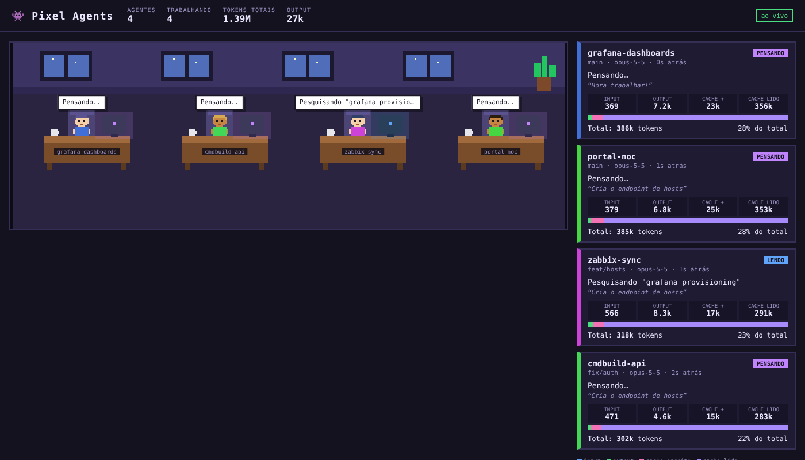

# 👾 Pixel Agents

Um escritório em pixel art onde **cada terminal do Claude Code vira um personagem**. Cada um mostra num balão o que está fazendo agora (lendo um arquivo, rodando um comando, delegando para um subagente, esperando você…) e o painel lateral mostra **quantos tokens cada um está gastando**.



## Como funciona

O Claude Code grava cada sessão em `~/.claude/projects/<projeto>/<sessão>.jsonl`. O servidor lê esses arquivos de forma incremental (como um `tail -f`), monta o estado de cada sessão e envia para o navegador via Server-Sent Events. Não usa nenhuma dependência externa, só Node.

| Estado        | Quando                                                        | No escritório                    |
|---------------|---------------------------------------------------------------|----------------------------------|
| `digitando`   | Edit, Write, Bash, TodoWrite, MCP…                           | digita no teclado                |
| `lendo`       | Read, Grep, Glob, WebFetch, WebSearch                         | olhando para a tela              |
| `delegando`   | Task/Agent (subagentes)                                       | robozinhos rosas ao lado da mesa |
| `pensando`    | recebeu um prompt ou o resultado de uma tool                  | balão "Pensando..."              |
| `aguardando`  | pergunta para você, ou tool rápida parada há mais de 10s (provavelmente pedindo permissão) | balão amarelo pulando |
| `livre`       | terminou a resposta e está esperando você                     | levanta e anda pelo escritório   |
| `dormindo`    | sem atividade há 30 min                                       | zZz                              |

### Tokens

Para cada sessão são somados, a partir do campo `usage` das respostas do modelo:

- **input**: tokens de entrada não cacheados
- **output**: tokens gerados
- **cache +**: tokens escritos no prompt cache
- **cache lido**: tokens lidos do cache

Mensagens repetidas no log (o Claude Code grava uma linha por bloco de conteúdo) são deduplicadas pelo `message.id`. Tokens de subagentes são somados ao terminal que os criou e aparecem separados no card.

## Uso

Requer Node 18+.

```bash
git clone https://github.com/GiovanneBordotti/pixel-agents.git
cd pixel-agents
npm start          # lê ~/.claude/projects
# ou
npm run demo       # 4 agentes falsos, para ver funcionando
```

Abra <http://localhost:4567>.

### Opções

| Flag              | Variável de ambiente  | Padrão          |
|-------------------|-----------------------|-----------------|
| `--port 4567`     | `PORT`                | `4567`          |
| `--host 0.0.0.0`  | `HOST`                | `127.0.0.1`     |
| `--hours 12`      | `PIXEL_AGENTS_HOURS`  | `12` (sessões com atividade nas últimas N horas) |
| `--claude-dir`    | `CLAUDE_CONFIG_DIR`   | `~/.claude`     |
| `--demo`          |                       | desligado       |

> Use `--host 0.0.0.0` se quiser abrir pelo celular na mesma rede. Atenção: isso expõe os prompts das suas sessões para a rede local.

## Estrutura

```
server.js          servidor HTTP + SSE
lib/session.js     estado de uma sessão (atividade + tokens)
lib/watcher.js     leitura incremental dos .jsonl
lib/demo.js        gerador de sessões falsas
public/            front-end (canvas pixel art + painel)
test/              testes (node --test)
```

## Testes

```bash
npm test
```
